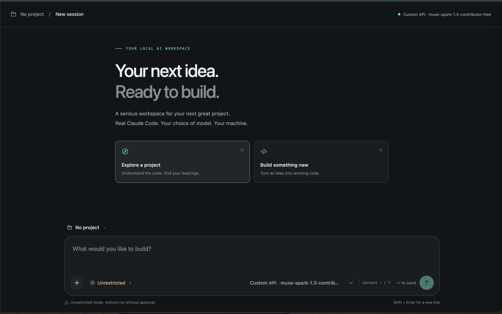
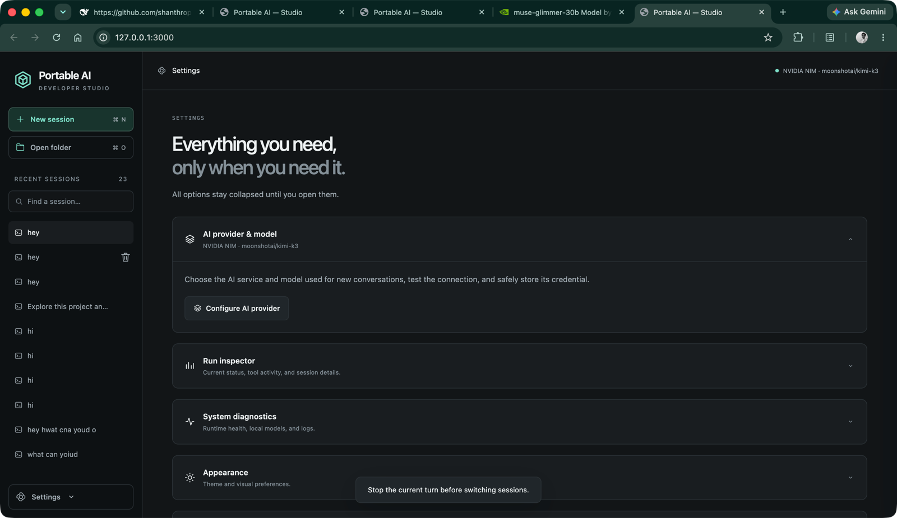
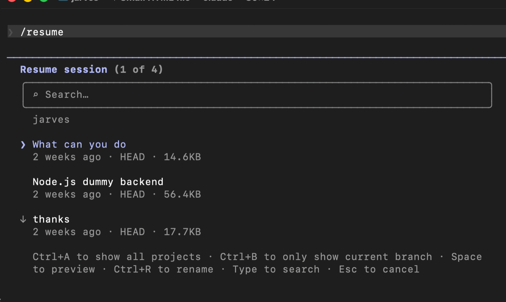

# Claude Code Portable — One USB. Any Model.

> **Run Claude Code from a USB drive or any folder—no global installation required. Connect to multiple AI providers, including OpenRouter, Google Gemini, NVIDIA NIM, custom APIs, and more.**
>
> Plug in. Launch. Code. Take it anywhere.

[](LICENSE)
[]()


**🎥 Watch the Setup & Demo Video:** [https://youtu.be/xPfZyV20_RY](https://youtu.be/xPfZyV20_RY)

[](https://youtu.be/xPfZyV20_RY)

---

## Gallery

### Main Dashboard



### Provider Settings



### Claude Code Terminal



---

## What Is This?

**ClaudeCode-Portable** is a fully portable AI coding workspace powered by the **official Anthropic Claude Code runtime and Agent SDK**. It bundles a self-contained Node.js runtime, nine provider configurations, a real Claude Code terminal, and a premium browser dashboard — all launched from `START.bat` on Windows or `start.sh` on Linux/macOS.

App-owned runtimes, provider settings, chat history, attachments, caches, and logs stay inside the project folder. Each operating system downloads its compatible runtime once and reuses it from the USB drive.

---

## Key Features

| Feature | Details |
|---|---|
| **Official Claude Code** | Uses Anthropic's official CLI and Agent SDK — no replacement agent engine |
| **9 AI Providers** | NVIDIA NIM · DeepSeek · OpenRouter · Google Gemini · Anthropic · OpenAI · Ollama · LM Studio · Custom API |
| **Portable Runtime** | Node.js, Claude Code, caches, settings, and app data stay in the project folder |
| **Zero Footprint** | `HOME`, `USERPROFILE`, `APPDATA`, `LOCALAPPDATA` and the XDG folders of every session point into `data/`; only the host Git config is linked back in, so commits keep your identity |
| **Git Bash Handling** | Uses an installed Git for Windows; downloads PortableGit only when none is present |
| **Local Speed Proxy** | Trims the ~10k-token system prompt for Ollama, cutting first-token latency on CPU hardware |
| **Studio Dashboard** | Streaming chat, Markdown, code highlighting, compact tool steps, approvals, attachments, and diagnostics |
| **Paste and Drop** | Paste a screenshot or drop files straight into the studio; images reach the model as real image blocks |
| **Shared Claude History** | GUI and portable terminal sessions use real Claude Code conversation IDs and can resume the same history |
| **Project + Normal Chats** | Work inside a selected folder or start an agent conversation without attaching a project |
| **Provider Switching** | Switch directly between configured provider/model profiles from the composer |
| **Custom Model Support** | Declare any model ID's context window; 1M windows also receive a Claude-compatible model-picker profile |
| **Update Check** | Option 7 compares pinned Claude Code and Agent SDK versions with npm and installs newer releases with automatic pin rollback |
| **Three Adapter Modes** | Built-in, external `claude-adapter`, and OpenAI Responses API support |
| **Cross-Platform** | Windows, Linux, and macOS runtimes can coexist on the same portable drive |

---

## Quick Start

### Windows

```powershell
.\START.bat
```

### Linux / macOS

```bash
chmod +x start.sh
./start.sh
```

On first launch, the project downloads checksum-verified **Node.js 26.13.1** and installs the pinned official Claude Code packages inside `engine/`. Every later launch reuses that installation.

> **First-time setup requires internet.** After setup, cloud providers still need internet; installed local Ollama models can run offline.

---

## Project Structure

```text
ClaudeCode-Portable/
│
├── START.bat                  Windows launcher
├── start.sh                  Linux/macOS launcher
├── RESUME.bat                Standalone session resume (Windows)
├── resume.sh                 Standalone session resume (Linux/macOS)
│
├── dashboard/                Browser studio interface
├── lib/                      Providers, adapters, sessions, runtime, Git, Playwright, and agent bridge
├── tests/                    Automated, smoke, live-provider, and UI fixture tests
├── tools/                    Launcher, runtime manifest, checks, speed proxy, and local-model setup
│
├── data/                     Portable settings, credentials, chats, attachments, and logs
│   ├── home/                 Redirected HOME/USERPROFILE of the Claude Code process
│   ├── config/, app_data/, local_app_data/, cache/   Redirected XDG/AppData folders
│   └── logs/proxy.log        Speed-proxy activity
└── engine/                   Per-platform runtimes
    ├── node-<os>-<arch>/
    ├── git-win-x64/          PortableGit — only when no system Git for Windows exists
    ├── playwright/           Browser automation package (pinned in tools/runtime-manifest.json)
    ├── playwright-browsers/  Headless Chromium build for Playwright
    └── <os>-<arch>/current/
```

`data/` and `engine/` are generated locally and ignored by Git.

---

## Main Menu Options

Run `START.bat` or `start.sh` to open:

```text
1  Open studio dashboard
2  Launch Claude Code terminal
3  Configure providers
4  Set up local models
5  Repair / update pinned runtime
6  Roll back runtime
7  Check for updates
8  Bypass permissions: ON
```

Pressing Enter selects the dashboard. Option 8 toggles the permission mode and returns to the menu.

### Launcher Commands

`START.bat` and `start.sh` accept the menu options as command-line arguments, plus maintenance commands. The numeric keys work only inside the interactive prompt; on the command line, use the names. On Linux/macOS, replace `START.bat` with `./start.sh` in every command below.

| Command | Action |
|---|---|
| `START.bat` | Open the interactive menu (Enter selects the dashboard) |
| `START.bat dashboard` | Option 1 — open the studio dashboard |
| `START.bat cli` | Option 2 — launch the Claude Code terminal |
| `START.bat --quick` | Same as `cli` |
| `START.bat --offline` | Same as `cli` |
| `START.bat resume <session-id>` | Resume an official Claude Code terminal session |
| `START.bat local-setup` | Option 4 — set up local models |
| `START.bat install` | Option 5 — install, repair, or update the pinned runtime |
| `START.bat update` | Same as `install` |
| `START.bat rollback` | Option 6 — restore the previous runtime |
| `START.bat check-update` | Option 7 — check npm for newer pinned releases and install them |
| `START.bat status` | Print runtime status as JSON |
| `START.bat permissions [on\|off\|status]` | Show or change the stored bypass-permissions mode |
| `START.bat use-ollama <model>` | Configure an installed Ollama model as the active profile |

Extra arguments after `cli` or `resume` are forwarded to the official Claude Code CLI, for example:

```powershell
.\START.bat cli --permission-mode acceptEdits
```

The model always comes from the active provider profile. Two launcher-only switches override the stored permission mode for a single launch and are not forwarded: `--safe` (approvals on) and `--unrestricted` (approvals off) — see [Permission Mode](#permission-mode-bypass-permissions).

### Environment Variables

| Variable | Effect |
|---|---|
| `PORTABLE_AI_PORT` | Dashboard port (default `3000`) |
| `PORTABLE_PROXY_PORT` | Local speed-proxy port (default `11435`) |
| `PORTABLE_PROXY_MAX_CHARS` | System-prompt budget for the proxy in characters (default `1200`, ≈300 tokens) |
| `PORTABLE_AI_DATA_DIR` | Use a different data folder (default `<project>/data`) |
| `PORTABLE_AI_NO_OPEN` | Do not open the browser when the dashboard starts |
| `PORTABLE_AI_NO_PAUSE` | Do not pause on launcher errors (`START.bat`, `RESUME.bat`) |
| `GIT_CONFIG_GLOBAL` | Overrides which Git configuration the session reads; by default the host `~/.gitconfig` is detected automatically |
| `PORTABLE_AI_NO_HOST_GIT_CONFIG` | Set to `1` to stop linking the host Git configuration into sessions |
| `PORTABLE_AI_NO_PLAYWRIGHT` | Set to `1` to skip the Playwright installation entirely |
| `PORTABLE_AI_HYPERLINKS` | Set to `1` to force OSC 8 hyperlinks in the terminal (exports `FORCE_HYPERLINK=1`) |
| `PLAYWRIGHT_BROWSERS_PATH` | Browser location; the launcher sets it to `engine/playwright-browsers` for its own installs |

---

## Permission Mode (Bypass Permissions)

Terminal launches start with **bypass permissions ON** by default: Claude Code runs commands and changes files without asking, and no `UNRESTRICTED` confirmation is required. The setting is stored as `preferences.bypassPermissions` in `data/settings.json`, so it survives restarts.

It applies to every terminal entry point:

- `START.bat cli` / `./start.sh cli` — also `--quick` and `--offline`, which both map to `cli`
- `START.bat resume <session-id>` / `./start.sh resume <session-id>`
- `RESUME.bat` / `./resume.sh`

### Turn it off permanently

| Windows | Linux / macOS | Effect |
|---|---|---|
| `START.bat permissions off` | `./start.sh permissions off` | Claude Code asks before changes |
| `START.bat permissions on` | `./start.sh permissions on` | Approvals disabled again |
| `START.bat permissions status` | `./start.sh permissions status` | Print the current mode |
| Menu option 8 | Menu option 8 | Toggles the mode, then returns to the menu |

The launcher prints the effective mode on every terminal launch (`Bypass permissions: ON/OFF`).

### Override it for a single launch

| Windows | Linux / macOS | Effect |
|---|---|---|
| `START.bat cli --safe` | `./start.sh cli --safe` | Approvals ON for this launch |
| `RESUME.bat --safe` | `./resume.sh --safe` | Approvals ON for this launch |
| `START.bat cli --unrestricted` | `./start.sh cli --unrestricted` | Approvals OFF for this launch |
| `RESUME.bat --unrestricted` | `./resume.sh --unrestricted` | Approvals OFF for this launch |

`--safe` and `--unrestricted` also work after a resume command, for example `START.bat resume <session-id> --safe`. They are launcher-only switches and are never forwarded to Claude Code. Passing `--dangerously-skip-permissions` or `--permission-mode bypassPermissions` yourself still requires typing `UNRESTRICTED`.

### Studio dashboard

The studio starts a turn with the same stored mode. Switching a single turn to **Unrestricted** in the composer still requires typing `UNRESTRICTED` for that turn.

---

## Resuming a Session (`RESUME.bat` / `resume.sh`)

`RESUME.bat` (Windows) and `resume.sh` (Linux/macOS) open Claude Code directly in an existing session. They bypass the launcher menu, provider setup, runtime installation and update checks, and read the active provider, model, and credential from `data/settings.json`. They follow the stored [permission mode](#permission-mode-bypass-permissions), which defaults to approvals disabled, so no `UNRESTRICTED` confirmation is needed.

```bat
RESUME.bat [<session-id>] [--resume <session-id>] [--cwd <directory>] [--safe | --unrestricted]
```

```bash
./resume.sh [<session-id>] [--resume <session-id>] [--cwd <directory>] [--safe | --unrestricted]
```

| Parameter | Description |
|---|---|
| `<session-id>` | Session ID to resume (a UUID such as `11ed2a6e-3b31-4535-8f47-25fcba70bede`). If no ID is given, the most recent session for the working directory is continued. |
| `--resume <session-id>` | Explicit form of the session ID — use either this or the positional ID, not both. |
| `--cwd <directory>` | Working directory for the resumed session. Defaults to the project folder. A directory passed positionally is accepted as well. The session list is scoped to this directory, so pass the project folder the session originally ran in. |
| `--safe` | Turn approval prompts on for this launch, overriding a stored ON. |
| `--unrestricted` | Turn approval prompts off for this launch, overriding a stored OFF. |

Session transcripts live under `data\claude\<provider>-<auth>\projects\<encoded-working-directory>\<session-id>.jsonl`; the file name without `.jsonl` is the ID to pass. The provider profile owns that directory, so a session is only found while the same provider profile is active.

Examples:

```bat
REM Continue the most recent session for the project folder
RESUME.bat

REM Resume a specific session by its ID
RESUME.bat 11ed2a6e-3b31-4535-8f47-25fcba70bede

REM Resume a session that belongs to a project folder
RESUME.bat --resume 11ed2a6e-3b31-4535-8f47-25fcba70bede --cwd "D:\Projects\my-app"

REM Continue the most recent session for a project folder
RESUME.bat --cwd "D:\Projects\my-app"
```

Notes:

- Run `START.bat` / `start.sh` at least once first — the resume entry points install, repair, and update nothing. They print a clear error when the portable Node.js runtime, the Claude Code executable, or the provider configuration is missing.
- Session ID and working directory can be combined in any order; duplicate `--resume` / `--cwd` values, unknown `--flags`, and malformed session IDs are rejected with an error.
- Without an ID, an empty history falls back to a new session after a warning.
- For approval prompts in a resumed session, add `--safe` (one launch) or run `START.bat permissions off` (permanent) — see [Permission Mode](#permission-mode-bypass-permissions).

---

## Supported AI Providers

| Provider | Connection | Get Started |
|---|---|---|
| **NVIDIA NIM** | Chat Completions adapter | [build.nvidia.com](https://build.nvidia.com) |
| **DeepSeek** | Anthropic-compatible API | [platform.deepseek.com](https://platform.deepseek.com) |
| **OpenRouter** | Anthropic-compatible API | [openrouter.ai](https://openrouter.ai) |
| **Google Gemini** | Chat Completions adapter | [aistudio.google.com](https://aistudio.google.com) |
| **Anthropic Claude** | Native Messages API / terminal login | [console.anthropic.com](https://console.anthropic.com) |
| **OpenAI** | Chat Completions adapter | [platform.openai.com](https://platform.openai.com) |
| **Ollama** | Local Anthropic-compatible endpoint | [ollama.com](https://ollama.com) |
| **LM Studio** | Local Anthropic-compatible endpoint | [lmstudio.ai](https://lmstudio.ai) |
| **Custom API** | Chat Completions or Responses API | Provider base URL + optional API key |

> **Non-Claude models are experimental and are not supported by Anthropic.** Tool calling, images, context limits, resume behavior, and other Claude Code features depend on the selected model and provider.

## Custom OpenAI-Compatible Provider

OpenAI-compatible providers can use:

- **Built-in** — streaming Chat Completions with tools and image support
- **External claude-adapter** — native/XML tool modes and optional model aliases; no image support
- **Responses API** — `/responses` support with incremental text and tool-argument streaming

All adapters bind only to `127.0.0.1` and use a fresh local token for every run.

Extended thinking is disabled automatically for adapter-backed providers because the Chat Completions and Responses protocols cannot carry thinking blocks. Set the model's context window in the dashboard so Claude Code uses the correct limit for custom IDs; a 1,000,000-token window also maps the ID to Claude's 1M model profile.

---

## LM Studio Setup

1. Download and load a tool-capable model in LM Studio.
2. Open **Developer → Local Server**.
3. Start the server.
4. In ClaudeCode-Portable, choose **LM Studio**.
5. Keep `http://127.0.0.1:1234` unless you changed the server address.
6. Discover the loaded model or enter its exact identifier.

LM Studio is managed by its own application. The dashboard connects to its running local server.

---

## Images and Attachments

### Studio dashboard

Three ways to attach a file, all landing in the same list above the composer:

| How | Notes |
|---|---|
| **Paste** — Ctrl+V / ⌘V in the message box | Compose or copy a screenshot, then paste. Text pastes are untouched. |
| **Drag and drop** | Drop anywhere in the studio window; the composer shows where the files will go. |
| **Attach button (+)** | Opens the file picker. |

Limits: 10 files, 20 MB in total, 10 MB per file, and **5 MB per image** — images travel to the model as base64, which grows by a third, and providers cap them well below the generic limit.

Attached **images** are sent as real image blocks, the same way the terminal attaches a clipboard screenshot, so a vision-capable model sees them without opening anything first. Other files stay paths in the prompt, which the agent inspects with its own tools.

### Terminal

The Claude Code terminal handles clipboard images itself:

1. Copy or take a screenshot (Win+Shift+S, or the snipping tool).
2. Press **Alt+V** in the Claude Code prompt on Windows. On macOS and Linux it is **Ctrl+V**.
3. The image is saved to a temporary PNG and attached to your next message.

**Why Alt+V and not Ctrl+V.** Claude Code binds image paste to `alt+v` on Windows (`ctrl+v` only on macOS, Linux, and WSL). The classic Windows console additionally swallows `Ctrl+V` for its own paste, so the key never reaches Claude Code — with a screenshot in the clipboard nothing happens. `Alt+V` works in both the classic console and Windows Terminal.

To make `Ctrl+V` work as well, the launcher adds it to the profile's `keybindings.json`; it takes effect on the next start. It only helps in a terminal that forwards the keystroke:

```json
{ "bindings": [{ "context": "Chat", "bindings": { "ctrl+v": "chat:imagePaste" } }] }
```

Two ways to get `Ctrl+V` through the classic console:

- Use **Windows Terminal** (the default on Windows 11). Set its paste shortcut to `Ctrl+Shift+V` if `Ctrl+V` still does not arrive.
- Or disable the console's own shortcuts for the current user, after which `Ctrl+V` belongs to the application and the console uses `Ctrl+Shift+V`/right-click instead:
  ```
  reg add "HKCU\Console" /v CtrlKeyShortcutsDisabled /t REG_DWORD /d 1 /f
  ```
  This changes every console window, not just Claude Code.

Pasting into the terminal needs a clipboard tool: PowerShell with `System.Windows.Forms` on Windows, `xclip` or `wl-paste` on Linux, `osascript` on macOS. If nothing is pasted, check that tool first. `START.bat` and this project's environment do not interfere with it.

---

## Local Ollama Models

Run the interactive portable setup:

```bash
bash start.sh local-setup
```

```powershell
.\START.bat local-setup
```

Local inference needs enough RAM/VRAM, a useful context window, and a model capable of tool calling. Model downloads can require several gigabytes.

### Automatic server and speed proxy

When the active profile is **Ollama**, every terminal launch (`START.bat cli`, `START.bat resume`, `RESUME.bat`) prepares the local stack on its own:

| Step | Behavior |
|---|---|
| Ollama server | The bundled `data/ollama/ollama.exe` is started if it is not already answering on `127.0.0.1:11434`. |
| Speed proxy | `tools/local-proxy.mjs` listens on `127.0.0.1:11435` and trims Claude Code's system prompt from ~10k tokens to ~300 before it reaches the model. |
| Routing | The session talks to the proxy; the proxy forwards to Ollama. If the proxy cannot start, the session uses Ollama directly and reports it. |
| Shutdown | Only processes started by that launch are stopped afterwards. A server or proxy you started yourself keeps running. |

If no bundled Ollama is installed, an external server is used as-is. Proxy activity is written to `data/logs/proxy.log` only, never to the terminal.

An OpenAI-compatible provider that is not Ollama (LM Studio, custom gateways) keeps using the endpoint configured in the dashboard.

---

## Clickable Paths and Links

### Studio dashboard

Local paths in a reply or a tool's output are clickable and open with your own application — Explorer for folders, the default program for files.

- Recognised: `D:\folder\file.png`, `C:/folder/file.png`, `\\server\share\file.pdf`, and `file:///D:/...`.
- A path with spaces is only recognised inside quotes (`"C:\Program Files\App\x.exe"`), because in running text a space is far more often the sentence than part of the name.
- Paths in code blocks stay plain text, so copying them still works.
- Web links open in a new tab; they never navigate the studio away.

A browser cannot start a local file from an HTTP page, so the click goes to the token-protected `POST /api/open`, which checks that the path is absolute and exists and then hands it to `explorer.exe` (Windows), `open` (macOS) or `xdg-open` (Linux). The path is passed as a single argument, never through a shell, so characters like `&` or quotes cannot become a command.

### Terminal

Claude Code renders local paths and URLs as OSC 8 hyperlinks, which terminals show clickable. It only does so in terminals it recognises:

| Terminal | Clickable paths |
|---|---|
| **Windows Terminal** | Yes, automatically — Ctrl+Click opens the path. |
| Classic console (`conhost`) | No: it sets no identifier, so Claude Code sends no escape sequences. |
| macOS Terminal, iTerm2, kitty, Warp, Ghostty, VS Code | Yes. |

To start the classic console's sessions in **Windows Terminal** instead, open Windows Terminal and run `START.bat` (or `RESUME.bat`) there. To force the escape sequences anyway, set `PORTABLE_AI_HYPERLINKS=1` before launching — it exports `FORCE_HYPERLINK=1`. Terminals without OSC 8 support will print the sequences as visible noise, which is why this is not enabled by default.

---

## Browser Automation (Playwright)

Playwright is installed next to the runtime and travels with the drive: the npm package in `engine/playwright`, the browser builds in `engine/playwright-browsers`. Nothing is written to the user profile.

| When | What happens |
|---|---|
| First launch | The pinned Playwright package and the headless Chromium build are installed, after the Claude Code runtime. |
| Every launch | Only a quick check runs. Missing pieces are fetched; a complete installation costs no network access. |
| Menu option 5 / `install` / `update` | Repairs both the runtime and Playwright. |
| Menu option 7 / `check-update` | Reports a newer Playwright release next to the Claude Code updates and installs it with the same pin rollback. |
| `--offline` | Skips every Playwright download. |
| `PORTABLE_AI_NO_PLAYWRIGHT=1` | Disables Playwright entirely. |

The version is pinned in `tools/runtime-manifest.json` (`"playwright": "1.65.1"`), because it decides which Chromium build is used — an unpinned update would download the browsers again. `--only-shell` installs the headless build only (~300 MB instead of ~750 MB). `--no-remove` is used so browser builds copied from another machine are not deleted; the `.links` file stores absolute paths, so after moving the folder run option 5 once.

### How a session learns that Playwright exists

A new session does not discover the bundled installation by itself — it sees a workspace and its own configuration, nothing else. The launcher therefore writes a **skill** into the profile directory (`data/claude/<provider>-<auth>/skills/portable-playwright/SKILL.md`) whenever Playwright is installed:

- Claude Code lists every skill's name and description in the system prompt, so the agent knows browser automation is available without paying for the full document up front.
- The agent loads the details only when the task calls for a screenshot or browser automation: the exact CLI path, the browsers folder, the `npx` warning, and the headless-only limitation.
- The paths are absolute, because a session's working directory is usually the user's project, not this folder.
- Without Playwright the skill is not written, and a stale copy is removed. A skill of your own in the same folder is never touched.

The profile directory is the right place: sessions run with `settingSources: ['user']`, so a `CLAUDE.md` inside a project is not loaded, while `~/.claude` — here `CLAUDE_CONFIG_DIR` — is.

```bash
# Windows
set "PLAYWRIGHT_BROWSERS_PATH=%CD%\engine\playwright-browsers"
engine\node-win32-x64\node.exe engine\playwright\node_modules\playwright\cli.js screenshot --viewport-size="1440,900" https://example.com shot.png
```

```js
// From project code (ESM)
import { chromium } from './engine/playwright/node_modules/playwright/index.mjs';
```

A failing Playwright install is a warning, never a startup error — Claude Code keeps working without it. `START.bat status` reports the Playwright state next to the runtime.

---

## Portable Runtime

| Component | Pinned Version |
|---|---|
| **Node.js** | `26.13.1` |
| **Claude Code** | `2.1.323` |
| **Claude Agent SDK** | `0.3.323` |
| **claude-adapter** | `2.2.1` |

Each OS/architecture stores its own runtime under `engine/`. Windows, macOS, Linux x64, and Linux ARM64 installations can coexist and are reused after their first download.

Linux drives that cannot create symbolic links—including common NTFS USB mounts—automatically use a link-free Node/npm layout. npm binary links are disabled because the launcher resolves the verified package executable directly. The same install flow avoids npm 10.9.8's Windows save-step crash.

Use menu options 5 and 6 to repair, update, or roll back the pinned runtime. Option 7 checks npm for newer Claude Code and Agent SDK releases and offers to install them.

Interrupted installations are resumed: staged files are kept and reused on the next attempt. If an installation fails, the previous verified runtime stays in place and details are written to `data/logs/runtime-install.log`. Option 7 saves the current pins first and restores them automatically if the newer installation fails.

---

## Security & Privacy

- Dashboard and adapter servers bind to `127.0.0.1` only.
- Every session process gets `HOME`, `USERPROFILE`, `APPDATA`, `LOCALAPPDATA`, `XDG_CONFIG_HOME`, `XDG_DATA_HOME` and `XDG_CACHE_HOME` redirected into `data/`, so files it writes stay on the drive.
- Claude Code needs Git Bash on Windows. An installed Git for Windows is used as-is; PortableGit is downloaded to `engine/git-win-x64/` only when none is found.
- The session still reads your real Git configuration: `GIT_CONFIG_GLOBAL` points at `~/.gitconfig` (or `~/.config/git/config`), so `git commit` keeps your author identity and credential helper. **This is a deliberate exception to zero-footprint:** `git config --global` inside a session writes to that file. Set `PORTABLE_AI_NO_HOST_GIT_CONFIG=1` to keep Git fully confined to the drive.
- Plain HTTP is allowed only for loopback, RFC 1918 LAN, IPv6 ULA/link-local, and link-local `169.254.0.0/16` hosts — which includes the cloud metadata address `169.254.169.254`. Traffic and API keys to those endpoints are unencrypted; use HTTPS or a trusted network.
- Dashboard APIs require a fresh access token printed at launch.
- Provider credentials are excluded from normal bootstrap/configuration responses.
- API keys are stored as plaintext in portable `data/settings.json`; protect the drive.
- Uploaded attachments remain inside private per-session folders under `data/`.
- Markdown is sanitized before rendering.
- Terminal launches run with bypass permissions ON by default, so commands and file writes execute without approval. Turn it off with `START.bat permissions off` / `./start.sh permissions off`, menu option 8, or `--safe` for a single launch — see [Permission Mode](#permission-mode-bypass-permissions).
- The studio dashboard starts turns with the same stored mode; switching a single turn to Unrestricted in the composer requires typing `UNRESTRICTED`.
- Prompts and relevant project content are sent to the provider you select.

Official account login and subprocess tools may still use operating-system facilities. This project is portable for app-owned files, but it is not a guaranteed zero-footprint sandbox.

---

## System Requirements

| Platform | Requirement |
|---|---|
| **Windows** | Windows 10 or later, PowerShell, and internet for first setup |
| **Linux** | Bash, `curl`, `tar`, glibc, and internet for first setup |
| **macOS** | Bash, `curl`, `tar`, and internet for first setup |

On Windows, Claude Code's shell tool needs Git Bash. An installed Git for Windows is detected automatically; PortableGit is downloaded into `engine/git-win-x64/` only when none is found. Alpine/musl Linux is not supported by the bundled Node.js bootstrap.

---

## Troubleshooting

| Symptom | Fix |
|---|---|
| `Claude Code on Windows requires git-bash` | `START.bat` uses an installed Git for Windows and otherwise downloads PortableGit to `engine/git-win-x64/`. Run `START.bat` once with internet access, or install Git for Windows. |
| Ollama responds very slowly | The speed proxy trims the system prompt automatically; check `data/logs/proxy.log` for the reduction. A smaller model (`gemma3:1b`) helps most on CPU-only hardware. |
| `The local speed proxy did not start on port 11435` | Another process owns the port. Stop it, or set `PORTABLE_PROXY_PORT` before launching; the session runs untrimmed until the port is free. |
| `Cannot create symlink ... Operation not permitted` on Linux USB | Pull the latest version and start again. NTFS/link-free mode is detected automatically. |
| `Cannot read properties of undefined (reading 'spec')` on Windows | Pull the latest version. Runtime installation now uses `--save=false`. |
| `Error: claude native binary not installed` on a pen drive | Pull the latest version and run option 5 (repair). The installer now detects the leftover placeholder and copies the native binary without hardlinks, which FAT32/exFAT drives block. |
| Node.js download looks stuck on Windows | Pull the latest version. `START.bat` now shows live progress with percent, MB downloaded, MB/s, and ETA, and retries interrupted downloads. |
| Launcher window closes immediately on a startup error | Pull the latest version. `START.bat` now pauses on failure so the message stays visible; set `PORTABLE_AI_NO_PAUSE` to skip the pause. |
| Folder picker opens behind the browser on Windows | Pull the latest version. The picker now opens as a topmost dialog and passes the selected folder correctly. |
| `Extended thinking is unavailable through the local protocol adapter` | Pull the latest version. Adapter-backed providers now disable extended thinking automatically. |
| `Unsupported content: tool_reference` | Pull the latest version. Claude Code's tool search references deferred tools in a block that only Anthropic's API understands; the adapters now skip it, because every tool schema is forwarded anyway. |
| `Invalid session ID` after using terminal mode on Windows | Pull the latest version. Windows Claude history paths are now parsed correctly. |
| Runtime installation was interrupted | Run option 5 or `start.sh install` again. Staged files are reused and the previous verified runtime is preserved; details are logged to `data/logs/runtime-install.log`. |
| Dashboard says disconnected | Use the newest tokenized URL printed by the currently running launcher. |
| Port 3000 is already in use | Stop the earlier dashboard or set `PORTABLE_AI_PORT` before launching. |
| Provider rejects the request | Read the full provider error shown in the chat and verify model/tool compatibility. |
| Image says `Unsupported content: image` | Choose a vision-capable model and the Built-in or Responses adapter. |
| Ollama or LM Studio is unavailable | Start the local model server and verify its base URL before discovering models. |
| USB installation is slow | Use a USB 3.x drive/port and allow the first runtime installation to finish. |

---

## License

MIT — use it, fork it, ship it.

Claude Code, the Agent SDK, and other dependencies keep their own licenses and terms. ClaudeCode-Portable is an independent interface and is not an official Anthropic product.
